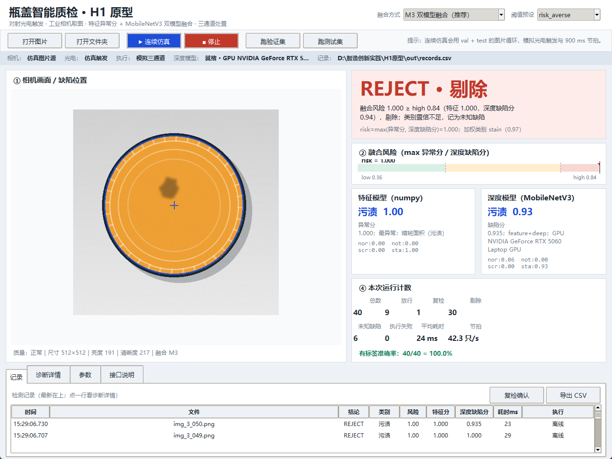
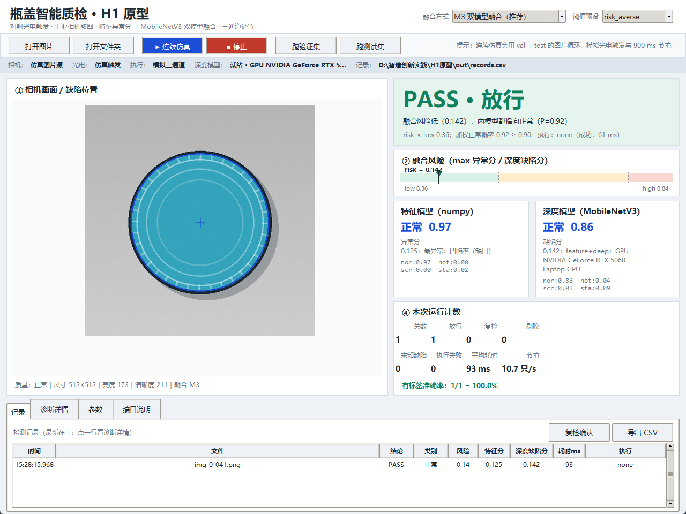
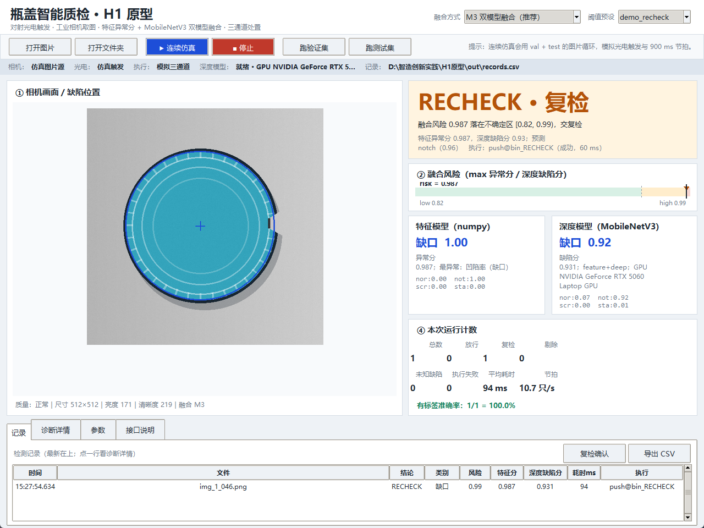
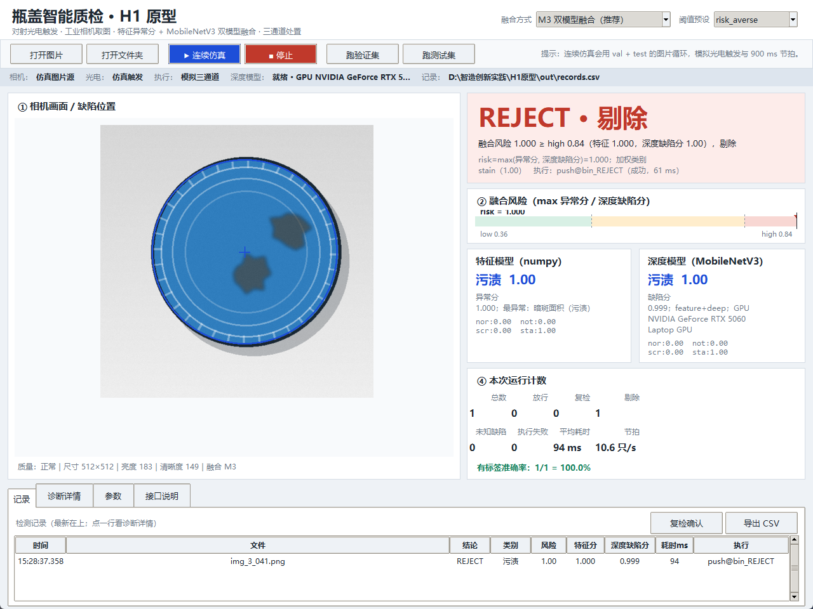
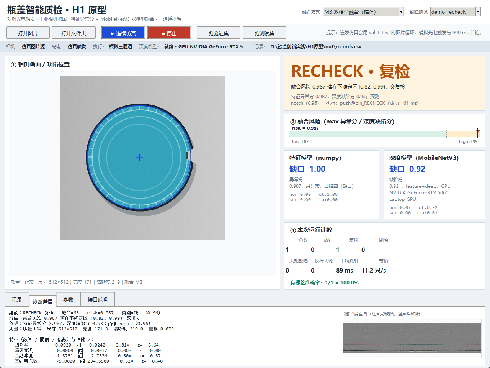
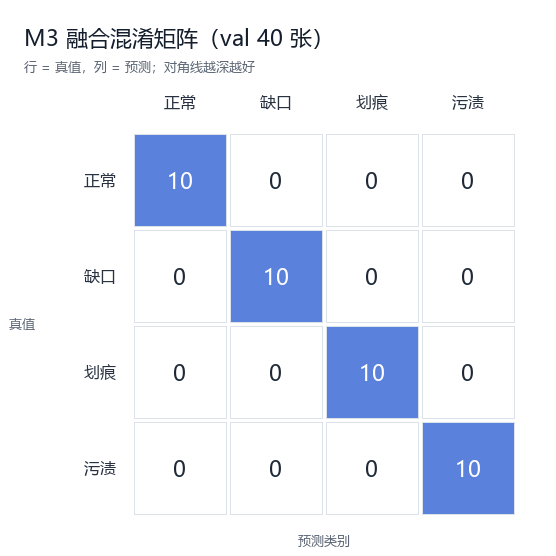

# 瓶盖智能质检 H1 原型

**双模型融合判断 + 三通道处置 + tkinter 单窗口操作台**

- 输入：瓶盖图片 / 文件夹 / 连续仿真（预留工业相机、对射式红外光电触发）
- 判断：特征异常分 + 特征分类器 + MobileNetV3-Small 深度模型，四种融合方式可切换
- 输出：`PASS`（放行）/ `RECHECK`（复检）/ `REJECT`（剔除），并显示类别、风险分、理由、耗时
- 执行：模拟三通道（挡板/推杆/传送带），预留 RoboMaster、PTK 舵机、达妙电机驱动接口
- 记录：逐只写入 `运行结果/records.csv`，支持复检结果回填 `运行结果/recheck_feedback.csv`
- 界面：一个窗口完成“看结果、看依据、调阈值、跑批量、看记录”，底部“接口说明”页直接告诉后来者四个插座在哪

> ⚠️ 课程数据是**教学合成图**（240 张，正常/缺口/划痕/污渍四类）。本文所有准确率只证明流程与对比方法，**不代表真实工业现场性能**；真实产线必须用现场图像重新标定阈值与基线。



---

## 1. 快速启动

### 1.1 一键启动

双击 `H1原型` 目录下的 **`启动.bat`**。

它会自动在上级目录递归查找带 `pyvenv.cfg` 的 `python.exe`（当前即支持文件夹里的 `..\支持文件\Python环境`，Python 3.12 + torch 2.11.0+cu128 + torchvision 0.26.0+cu128），不需要联网，也不污染系统 Python。

### 1.2 命令行启动

```bat
cd /d D:\智造创新实践\H1原型
..\支持文件\Python环境\Scripts\python.exe ui\app.py
```

### 1.3 第一次启动会慢十几秒

首次加载 MobileNetV3 时 CUDA 要初始化（本项目实测首次推理可能 10–20 s），状态条会显示“加载中…”。**等状态条变成“就绪 · GPU …”再点检测**，之后单张稳定在 **80–100 ms**（含 60 ms 模拟执行）。

如果电脑没有 NVIDIA GPU / 没有装 torch：程序不会崩，状态条显示“不可用”，自动回退到 **M0 纯特征模式**；记录里 `backend` 会写 `mode_fallback=M0`。

### 1.4 环境说明

- 支持文件夹里的 `..\支持文件\Python环境` 是完整可复用环境，约 4.4 GB；`..\支持文件\离线安装包\wheels\` 是离线安装包，约 2.7 GB，**不属于程序交付物**，可删除或移到别的盘。
- 重新安装见 [`文档/环境与离线安装.md`](文档/环境与离线安装.md)。
- 只依赖 `numpy`、`Pillow`、`torch`、`torchvision`；界面用标准库 `tkinter`，不装 PyQt。

### 1.5 完整性检查与自动恢复

`启动.bat` 在打开界面前会先跑 `check_integrity.py --auto`：核对运行必需文件（源码、模型、240 张数据）的 sha256；`config.json`、README、文档、工具、测试这类会被人修改的文件只查“是否存在”，不校验哈希，避免调阈值后被误判。同时检查 `支持文件/Python环境` 里的 torch/torchvision/numpy/Pillow 等 13 个包。

- **文件缺失**：优先从 `..\支持文件\安装缓存\H1原型资源.zip` 恢复；如果 `config.json` 的 `integrity.source_base` 配了 HTTP 地址，则从该地址下载对应相对路径。
- **Python 包缺失/版本不符**：先调用 `工具/fetch_wheels.py` 下载缺的 wheel，再按缺失包名 `pip install --no-index --no-deps --force-reinstall` 离线安装；torch 约 2.6 GB，第一次补包会比较久。
- **源码/模型/数据哈希不符**：默认只报告、不覆盖，以免误删你的修改；确认要恢复时运行 `--auto --force`。
- **清单或缓存本身也没了**：先运行 `工具/生成完整性清单.py` 重新生成（需要当前文件基本齐全）；更推荐从完整交付包恢复。

手动检查 / 修复：

```bat
cd /d D:\智造创新实践\H1原型
..\支持文件\Python环境\Scripts\python.exe check_integrity.py --check
..\支持文件\Python环境\Scripts\python.exe check_integrity.py --auto
..\支持文件\Python环境\Scripts\python.exe check_integrity.py --auto --force
```

> 如果整个 `..\支持文件\Python环境` 都没了，`启动.bat` 找不到 Python，脚本无法自行创建解释器；请按 [`文档/环境与离线安装.md`](文档/环境与离线安装.md) 第 3 节重建环境，再运行自动检查。

---

## 2. 界面怎么用

### 2.1 布局

| 区域 | 内容 |
|---|---|
| 顶部标题行 | 融合方式（M3 推荐 / M1 / M2 / M0）、阈值预设 |
| 第二行工具栏 | 打开图片、打开文件夹、▶ 连续仿真、■ 停止、跑验证集、跑测试集 |
| 状态条 | 相机 / 光电 / 执行 / 深度模型 / 记录文件 |
| 左侧 | 原图 + 圆心/外圆 + 小缺陷框 |
| 右侧 | 大结论卡、融合风险条、特征模型卡、深度模型卡、本次运行计数、有标签准确率 |
| 底部 Tab | 记录表、诊断详情、参数、接口说明 |

### 2.2 三种典型操作

1. **单张看依据**：点“打开图片”选一张，右侧立即显示结论、两个模型分别的概率、融合风险、执行动作、耗时；点底部“诊断详情”可看四个特征值/阈值/倍数/z 值、摊平偏差图、时间戳。
2. **整批看指标**：点“跑验证集”或“跑测试集”，自动逐张检测，底部记录表滚动，计数卡显示 PASS/RECHECK/REJECT、未知缺陷、平均耗时、有标签准确率。
3. **连续演示（≥20 只）**：点“▶ 连续仿真”，用 val + test 图片循环，模拟光电触发和 900 ms 传送带节拍；点“■ 停止”结束后底部会打印本次统计。答辩视频建议用这个模式，能同时展示三种处置。

### 2.3 三种结论的截图

| PASS 放行 | RECHECK 复检 | REJECT 剔除 |
|---|---|---|
|  |  |  |
| 正常瓶盖，双模型都指向正常 | 缺口瓶盖，风险落在复检带 | 污渍瓶盖，风险超过高阈值 |

> 复检截图使用 `demo_recheck` 预设（low=0.8214 / high=0.9868），专门为了让“复检”分支出现在演示里；默认 `risk_averse` 预设更保守，val 上复检很少。

诊断详情页（四特征数值/阈值/倍数/z + 摊平偏差图）：



### 2.4 调阈值

底部 **参数** 页可以拖动 `low` / `high` / `conf_min` / 融合权重，点“应用”立即生效，点“保存”写回 `config.json`。顶部“阈值预设”提供：

| 预设 | low | high | 用途 |
|---|---|---|---|
| `risk_averse` | 0.3607 | 0.8371 | 默认，尽量不漏检 |
| `balanced` | 0.4930 | 0.7048 | 复检/剔除更均衡 |
| `demo_recheck` | 0.8214 | 0.9868 | 演示复检分支 |
| `course` | 0.50 | 0.90 | 课程演示的直观阈值 |
| `starter_kit` | 0.20 | 0.80 | 基础版原始阈值口径 |

---

## 3. 判断方案：为什么是“混合 + 串联”

### 3.1 三条证据链

| 链路 | 做法 | 强项 | 弱项 |
|---|---|---|---|
| A. 特征异常分 | 找圆心→极坐标摊平→按行减中位数→量缺口/暗斑/直线纯度/带点数；用正常品 median/MAD 算稳健 z，`score=1-exp(-max_z/2)` | 不需要缺陷样本；可解释；能抓“训练集没见过的异常” | 对光照/工装变化敏感 |
| B. 特征分类器 | 四个特征 → 标准化 → 手写 softmax 回归（train 内 5 折 CV 选型） | 极轻；CPU 也快；概率可读 | 只见过训练集里的缺陷形态 |
| C. 深度模型 | 基础版 MobileNetV3-Small，四分类，只训练最后输出层；预处理 `ToTensor+Normalize` | 对划痕/污渍的纹理更稳；补上 A/B 的错例 | 需要 torch；首次加载慢；黑盒 |

> 注意：MobileNetV3-Small 是**轻量 CNN**，不是“大模型”。基础版 `model.pth` 只有 6 MB，且只训练了最后一层。

### 3.2 四种融合方式（GUI 可切换）

| 模式 | 逻辑 | val 准确率 | 漏检 | 正常误剔 | 复检率 | 平均耗时 |
|---|---|---|---|---|---|---|
| M0 | 只用特征：异常分门卫 + 特征分类器 | 97.50% (39/40) | 0 | 0 | 0% | 22.2 ms |
| M1 | 特征异常分当门卫，深度模型做分诊 | 97.50% (39/40) | 0 | 0 | 12.5% | 22.6 ms |
| M2 | 深度缺陷分当门卫，特征模型做分诊 | 97.50% (39/40) | 0 | 0 | 2.5% | 22.7 ms |
| **M3（默认）** | **双模型证据融合** | **100.00% (40/40)** | **0** | **0** | **2.5%** | **22.7 ms** |

选择规则按小组约定的优先级：**零漏检 > 准确率 > 少误剔 > 低延迟 > 低复检**。M3 在 val 上 40/40，且没有漏检/误剔，因此设为默认。

### 3.3 M3 的具体算法

设：

- `a` = 特征异常分（0–1，越大越异常）
- `d` = 深度缺陷分 = `P(缺口)+P(划痕)+P(污渍)`
- `p_feat`、`p_deep` = 两个模型对四类的概率
- `w = 0.5` = 深度模型权重

则：

```text
risk = max(a, d)                         # 任一模型认为异常，都不能轻易放行
p     = (1-w) * p_feat + w * p_deep      # 加权后的四类概率
pred  = argmax(p)
```

决策：

```text
if 质量门不过:                 RECHECK（感知异常，停线/人工接管）
elif risk >= high:             REJECT
elif risk >= low:              RECHECK
elif pred == normal 且 p_normal >= 0.9:  PASS
else:                          RECHECK
```

如果 `pred == normal` 或 `max(p) < conf_min`，但 `risk >= high`，会标 **“未知缺陷”**（`is_unknown=True`）——动作仍是 REJECT，但记录里会提示“类别置信不足，建议人工确认”。val 上 M3 有 6 个这样的样本，全部是缺陷，**没有漏检**。

### 3.4 质量门与异常处理

检测前先做质量门（`core/quality.py`）：

- 尺寸：短边 ≥ 256、长边 ≤ 4096；
- 曝光：平均亮度 25–245；
- 清晰度：拉普拉斯方差 ≥ 30；
- 居中：圆心偏移 ≤ 0.35R；
- 任何一项不过 → 直接 `RECHECK`，理由写“质量门”，**绝不放行**。

读图失败、特征测量异常、模型抛异常：统一转 `RECHECK`，`act` 记录 `stop_line`（停线），并在记录里写 `error`。这对应 H1 的“无图像 / 输入异常 / 模型不确定”要求。

---

## 4. 数据、模型与复现结果

### 4.1 数据

```text
数据/dataset/
  images/train/{normal,notch,scratch,stain}/   160 张
  images/val/{normal,notch,scratch,stain}/      40 张
  images/test_unlabeled/{...}/                  40 张
  labels_train_val.csv                          file_name,class_name
```

- 240 张 512×512 PNG，四类各 60 张；train 160 / val 40 / test_unlabeled 40。
- `test_unlabeled` 没有标签，用于演示“真实产线只给图”的流程；本报告的数字只来自 val。

### 4.2 模型文件

| 文件 | 作用 |
|---|---|
| `模型/baseline.json` | 正常品四特征的 median/MAD，异常分基线 |
| `模型/classifier.json` | 特征标准化参数 + 手写 logreg 权重 |
| `模型/model.pth` | 基础版 MobileNetV3-Small 四分类权重（6 MB） |

### 4.3 复现命令

```bat
cd /d D:\智造创新实践\H1原型
..\支持文件\Python环境\Scripts\python.exe 工具\eval_fusion.py
..\支持文件\Python环境\Scripts\python.exe 工具\export_val.py
..\支持文件\Python环境\Scripts\python.exe 工具\demo_run.py --samples 24 --preset demo_recheck --cycle-ms 200
..\支持文件\Python环境\Scripts\python.exe -m unittest discover -s 测试 -v
..\支持文件\Python环境\Scripts\python.exe ui\app.py --smoke
```

输出：

- `运行结果/fusion_eval.md` / `.json`：M0–M3 对比；
- `运行结果/val_predictions_m3.csv` / `val_confusion_m3.png` / `val_per_class_m3.md`：逐张预测、混淆矩阵、分类别指标；
- `运行结果/demo_run.md` / `.json` / `demo_records.csv`：24 只连续演示；
- `运行结果/records.csv`：界面运行时的逐只记录；
- `运行结果/recheck_feedback.csv`：复检回填。

### 4.4 24 只连续演示结果

按类别均衡从 val 抽 6×4=24 只，`demo_recheck` 阈值，模拟 200 ms 节拍：

| 指标 | 结果 |
|---|---|
| 处置 | PASS 6 / RECHECK 1 / REJECT 17 |
| 有标签准确率 | 24/24 = 100% |
| 漏检（缺陷被 PASS） | 0 |
| 正常误剔（正常被 REJECT） | 0 |
| 未知缺陷标记 | 4 |
| 执行失败 | 0 |
| 平均端到端耗时 | 83.0 ms/只（不含节拍） |
| 总墙钟 | 6.61 s |

完整逐只表见 [`运行结果/demo_run.md`](运行结果/demo_run.md)。

一个能说明“为什么要双模型”的例子：`img_2_045.png`（划痕）的深度缺陷分只有 **0.217**，单靠深度模型会接近正常；但特征异常分是 **0.994**，M3 取 `max` 后 risk=0.994 → REJECT。基础版 README 也提到这张曾被判 `normal`、靠阈值才进复检——这正是“特征兜底 + 深度补充”的互补证据。

M3 在 val 40 张上的混淆矩阵（每类 10 张，全部落在对角线）：



---

## 5. 目录结构

```text
D:\智造创新实践\
├─ H1原型/                        软件本体（本目录）
│  ├─ 启动.bat                     一键启动（先做完整性检查）
│  ├─ check_integrity.py           完整性检查/自动恢复
│  ├─ 完整性清单.json              文件 sha256 清单（282 项）
│  ├─ config.json                  所有阈值/路径/硬件参数（含 integrity 段）
│  ├─ core/                        判断内核（不依赖 tkinter；Python 包名保持英文）
│  │  ├─ types.py                  类别/动作/结果数据结构
│  │  ├─ config.py                 配置与数据划分
│  │  ├─ features.py               圆心/摊平/四特征
│  │  ├─ anomaly.py                正常品基线 + 异常分
│  │  ├─ classifier.py             特征分类器（logreg 等）
│  │  ├─ deep_model.py             MobileNetV3 后端（懒加载、失败可回退）
│  │  ├─ fusion.py                 M0–M3 融合
│  │  ├─ quality.py                质量门
│  │  └─ pipeline.py               Inspector：一张图的完整流水线
│  ├─ devices/                     设备层（输入/执行/记录/仿真；Python 包名保持英文）
│  │  ├─ base.py                   FrameSource / Dispatcher / Recorder / FeedbackSink
│  │  ├─ sources.py                文件夹/回放/视频/相机/光电桩
│  │  ├─ actuators.py              RoboMaster / PTK / 达妙 / 组合执行器
│  │  └─ sim.py                    仿真产线（节拍/统计）
│  ├─ ui/app.py                    tkinter 操作台（Python 包名保持英文）
│  ├─ 工具/                        eval_fusion / export_val / demo_run / snap_gui / fetch_wheels / 生成完整性清单
│  ├─ 测试/test_core.py            15 项单元测试
│  ├─ 模型/                        baseline / classifier / model.pth
│  ├─ 数据/dataset/                240 张教学合成图
│  ├─ 运行结果/                    记录、评测、截图
│  └─ 文档/                        接口文档、环境说明、交接材料
├─ 支持文件/                       Python 环境、离线安装包与恢复缓存
│  ├─ Python环境/                  venv（约 4.4 GB）
│  ├─ 离线安装包/wheels/           离线 wheel（约 2.7 GB）
│  └─ 安装缓存/H1原型资源.zip      项目文件恢复缓存（约 51 MB）
└─ 参考资料/                       旧对照实现与早期报告材料
   ├─ 特征识别/
   ├─ 早期报告材料/
   └─ 方案文档/
```

> `core/`、`devices/`、`ui/` 是 Python 的 import 包名，必须保持英文；数据、模型、运行结果、文档、工具、测试等不参与 import 的目录已改为中文名。启动脚本会在上级目录递归查找带 `pyvenv.cfg` 的 `python.exe`。

---

## 6. 四个“插座”（后期改动入口）

完整字段、示例代码和验收方法见 **[`文档/接口文档.md`](文档/接口文档.md)**。这里只给一句话版本：

| 插座 | 现在 | 以后怎么加 | 改哪里 |
|---|---|---|---|
| 检测输入 | 文件/文件夹/视频/仿真 | 工业相机、对射光电触发、PLC 信号 | 新类实现 `FrameSource.iter_frames()` |
| 执行输出 | 模拟挡板/推杆 | RoboMaster 传送带、PTK 挡板、达妙推杆 | 实现 `MotorDriver` 子类 + `build_dispatcher()` |
| 反馈记录 | CSV + 复检回填 CSV | SQLite/MES/JSONL、人工复核结果 | 实现 `Recorder.record()` / `FeedbackSink.submit()` |
| 可视化 | tkinter 单窗口 | Web/大屏/换布局 | 只订阅 `InspectionResult`，`core/` 不依赖 Tk |

`core/pipeline.py` 的 `Inspector` 是唯一的“总装线”：

```python
res = inspector.inspect(image_or_path, dispatch=True)
res.action        # PASS / RECHECK / REJECT
res.pred          # normal / notch / scratch / stain
res.risk          # 融合风险 0–1
res.anomaly_score # 特征异常分
res.deep.defect_score
res.fusion.reason # 给操作员看的中文理由
res.elapsed_ms    # 端到端耗时
res.to_record()   # 52 列记录（可直接进 CSV/SQLite）
```

---

## 7. 真实硬件怎么接

### 7.1 对射式红外光电开关

- 常见 NPN 常开输出：接 PLC 输入点 / 单片机 GPIO / USB 采集卡；串口模块则读上升沿。
- 软件去抖 10–50 ms；同一只瓶盖挡光期间只触发一次，必须“离开→再来”才产生下一事件（`SensorTriggerSource` 注释里写了）。
- 触发时刻记 `ts_sense`，用于算在途位置和延时补偿。

### 7.2 工业相机

- 海康 MVS：`MV_CC_SetEnumValue("TriggerMode", MV_TRIGGER_MODE_ON)`，`TriggerSource=LINE0`，光电上升沿硬触发，`MV_CC_GetImageBuffer()` 取图。
- USB 相机（OpenCV）：`cv2.VideoCapture` + 外触发/软件触发，不要死循环 `read()`。
- 输入必须是 **512×512 RGB**（基础版模型不裁剪、不缩放）；现场若分辨率不同，先在 `CameraSource` 里做居中裁剪/缩放，或在 `DeepModel._prepare` 里统一。

### 7.3 执行机构分工（建议，可按实际机构改）

| 设备 | 建议角色 | 接口 |
|---|---|---|
| 大疆 RoboMaster M3508/C620 | 传送带/转盘主动力 | `RoboMasterConveyor.set_speed_rpm()`，CAN 1 Mbps，`0x200+ID` 电流帧 |
| PTK 总线舵机 | 三通道挡板：PASS 0° / RECHECK 35° / REJECT 70° | `PTKServoGate.set_angle()`，串口/总线，角度现场标定 |
| 达妙 DM4310/DM4340 | 剔除推杆 | `DamiaoPusher.push()/retract()`，CAN，MIT/位置模式，读编码器到位 |

### 7.4 时序与延时补偿

```text
delay_comp_ms = (sensor_to_camera_mm + camera_to_actuator_mm) / conveyor_speed_mm_s * 1000
track_pos_mm  = conveyor_speed_mm_s * (ts_decide - ts_trigger) / 1000
late          = (ts_decide - ts_trigger)*1000 > delay_comp_ms
```

`config.json` 的 `line` 段：`conveyor_speed_mm_s=120`、`sensor_to_camera_mm=40`、`camera_to_actuator_mm=180`，算下来补偿 1833 ms；当前软件分析只要 20–100 ms，所以 `late=False`。真机把实测距离/速度填进去即可。

执行确认：`CompositeDispatcher` 已经预留超时/未连接/异常三条失败路径；真机要轮询限位/编码器，超时返回 `ActResult(ok=False)`，界面计数“执行失败”+记录 `act_ok=0`。

> 当前仓库里三个电机驱动的方法体是**故意留的 `NotImplementedError`**：没有实机时不允许假装电机动了。`build_dispatcher(cfg, "hardware")` 会构造组合执行器，但 `connect()` 会明确报“未接入”。

---

## 8. 记录格式

`运行结果/records.csv` 每行一只瓶盖，52 列，按组记忆：

- 身份/时间：`frame_id`、`path`、`label`、`ts_*`（trigger/capture/analyze/decide/act/ack/feedback）、`elapsed_ms`、`analysis_ms`
- 质量：`quality_ok`、`quality_reason`、`mean_lum`、`sharpness`、`center_offset`
- 特征：`notch`、`dark`、`purity`、`peak`、`anomaly_score`、`worst_feature`、`z_*`
- 模型：`feat_pred/feat_conf/feat_defect`、`deep_pred/deep_conf/deep_defect`、`deep_available`
- 融合/决策：`fusion_mode`、`risk`、`action`、`reason`、`is_unknown`、`rule`
- 执行：`act_ok`、`act_cmd`、`act_ack_ms`、`act_detail`
- 产线：`track_pos_mm`、`delay_comp_ms`、`queue_depth`、`late`、`backend`
- 版本：`schema_version`（当前 `h1.2`）

表头变化时 `CsvRecorder` 会自动把旧文件改名为 `.old_时间戳`，避免“旧表头 + 新字段”错位。

复检回填：界面记录表选中一行 → “复检确认” → 选最终处置/写备注 → 追加到 `运行结果/recheck_feedback.csv`（`ts/frame_id/original_action/final_action/note/operator`）。

---

## 9. 测试与 H1 验收对照

### 9.1 自动化测试

```bat
..\支持文件\Python环境\Scripts\python.exe -m unittest discover -s 测试 -v
```

15 项：配置/数据划分、四特征、决策四分支、M3 正常/缺陷/单模型报警、质量门、深度不可用回退、pipeline 5 张、CSV 表头。

### 9.2 H1 要求对照

| H1 要求 | 本原型对应 |
|---|---|
| 可运行程序/交互仿真 | `ui/app.py` + `启动.bat`；无实机也能跑连续仿真 |
| 图像/视频输入 → 类别、异常分、位置 | 四类 + 异常分 + 风险条；小缺陷框；`test_unlabeled` 可跑视频/文件夹 |
| PASS/RECHECK/REJECT 三分支 | M3 决策 + GUI 三种颜色卡 |
| 阈值可调 | 参数页滑块 + 5 个预设 + `config.json` |
| 显示/记录检测时间、模型结果、处置 | GUI 记录表 + `records.csv` 52 列 |
| 无图像/模型不确定/输入异常 | 质量门、异常转 RECHECK、深度不可用回退 M0 |
| 测试集与漏检/误检分析 | `eval_fusion.py`、`demo_run.py`、`fusion_eval.md` |
| 连接真实 Camera/Sensor/执行机构 | `devices/sources.py` / `actuators.py` 桩 + 接线注释 + 时序补偿 |
| ≥20 连续样本、正常+两类异常、两种处置 | 24 只：6 正常 + 18 缺陷（缺口/划痕/污渍），PASS/RECHECK/REJECT 三种 |
| 保存/显示结果 | CSV + 界面 + 截图 |
| AI 使用申明 | 见第 11 节 |

---

## 10. 已知限制

1. **数据是教学合成图**，背景干净、光照稳定；真实产线要重新采图、重标阈值，不能直接套 40/40。
2. 深度模型只训练了最后一层，容量有限；它的价值是“补特征模型的错例”，不是替代特征模型。
3. 三个电机驱动、工业相机、光电串口都是**接口桩**，没有实机联调；`hardware` 模式会明确报未接入。
4. PTK 三通道角度（0/35/70°）是占位值，必须按机构标定。
5. 复检确认目前只写 CSV，没有和 MES/工单系统对接。
6. 连续仿真用图片回放，不是真实传送带；节拍、在途队列、延时补偿逻辑是真的，但物理惯性/打滑没有模拟。

---

## 11. AI 使用申明

- 本原型的代码、界面、文档在 AI 编程助手辅助下完成；算法选型、阈值、评测口径由小组确认。
- 数据来自课程提供的教学合成数据集；`model.pth` 来自课程“瓶盖质检基础版”，本项目只做推理与融合，没有伪造训练结果。
- 文中所有数字均由仓库内脚本可复现（命令见 4.3），没有手工编造；截图来自实际运行窗口。
- 真实硬件未接入，文档中涉及相机的接线/触发方式为**实现指引**，不是“已联调”的结论。

---

## 12. 交接材料

- [`文档/接口文档.md`](文档/接口文档.md)：四个插座的字段、示例、验收清单
- [`文档/环境与离线安装.md`](文档/环境与离线安装.md)：venv、torch cu128、wheel 安装、常见错误
- [`文档/模型方案总结.md`](文档/模型方案总结.md)：单模型 vs M3 的完整对比、互补样本、公式、选型建议
- [`文档/交接_报告PPT视频.md`](文档/交接_报告PPT视频.md)：报告结构、PPT 页序、视频分镜、答辩口径
