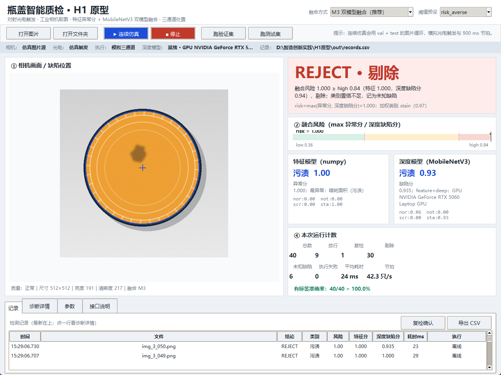

# 瓶盖智能质检 H1 原型

基于工业相机图像的瓶盖缺陷检测与三通道自动处置原型。默认使用 **M3 双模型融合**：

- 特征模型：正常品基线做无监督异常分，判断“离正常有多远”；
- 深度模型：课程基础版 MobileNetV3-Small，判断“像哪一类缺陷”；
- 融合判决：`risk = max(异常分, 深度缺陷分)`，输出 **PASS / RECHECK / REJECT**，并驱动仿真执行机构。



## 快速开始

```bat
git clone https://github.com/enterprisewxt0704/wu.git
cd wu\H1原型
启动.bat
```

> 仓库只包含源码、模型、数据和运行结果（约 52 MB）。约 4.4 GB 的 Python 环境和 2.7 GB 离线 wheel **没有入库**；换机时按 [环境与离线安装](H1原型/文档/环境与离线安装.md) 重建，或把 `支持文件\` 放到 `H1原型\` 同级目录。

没有 GPU 也能跑：把 `config.json` 的 `deep.enabled` 改成 `false`，会自动回退到纯特征 M0。

## 主要入口

| 内容 | 位置 |
|---|---|
| 一键启动（先完整性检查） | [`H1原型/启动.bat`](H1原型/启动.bat) |
| 完整运行说明 | [`H1原型/README.md`](H1原型/README.md) |
| 接口文档（检测输入/执行输出/记录/界面替换） | [`文档/接口文档.md`](H1原型/文档/接口文档.md) |
| 模型与融合方案 | [`文档/模型方案总结.md`](H1原型/文档/模型方案总结.md) |
| 报告/PPT/视频交接 | [`文档/交接_报告PPT视频.md`](H1原型/文档/交接_报告PPT视频.md) |
| 完整性检查 | [`H1原型/check_integrity.py`](H1原型/check_integrity.py) |
| 目录说明 | [`目录说明.md`](目录说明.md) |

## 已验证结果

- val 40 张：分类准确率 **40/40**，漏检 **0**，正常误剔 **0**，复检 1 只（2.5%），GPU 平均约 **20.5 ms/张**。
- 24 只连续仿真：PASS 6 / RECHECK 1 / REJECT 17，准确率 24/24，执行失败 0。
- 融合对比：M0/M1/M2 为 39/40，M3 为 40/40；M3 修正了 `img_2_042` 的特征误判。
- 完整性自检：282 项文件 + 13 个 Python 包；缺失文件从本地缓存恢复，缺失 wheel 自动下载，缺失包按需离线安装。

## 目录

```text
wu/
├─ H1原型/            源码 + 模型 + 数据 + 运行结果 + 文档
│  ├─ core/ devices/ ui/    Python 包（必须保持英文 import 名）
│  ├─ 数据/ 模型/ 运行结果/ 文档/ 工具/ 测试/
│  ├─ config.json
│  ├─ check_integrity.py
│  └─ 启动.bat
├─ 目录说明.md
└─ .gitignore         环境、wheel、缓存和大压缩包不入库
```

## 说明

- 数据集为课程提供的教学合成图，结果只代表该数据集，不宣称真实产线性能。
- 硬件接口（海康相机、对射式光电、RoboMaster/PTK/达妙）已按契约预留，当前以仿真线验证；真实联调需按接口文档填参数。
- 详细限制与 AI 使用申明见 [H1原型/README.md](H1原型/README.md)。
